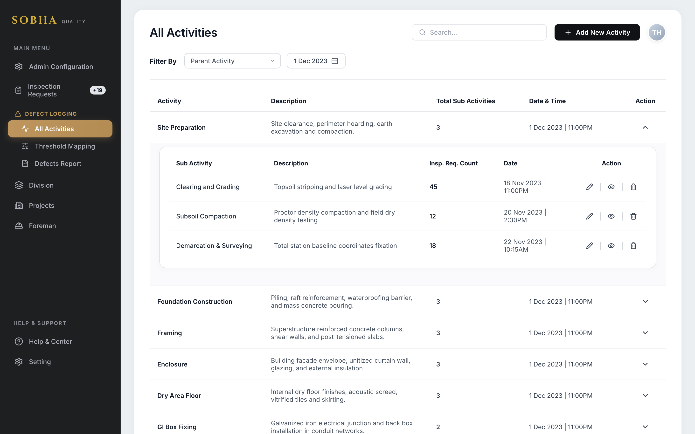
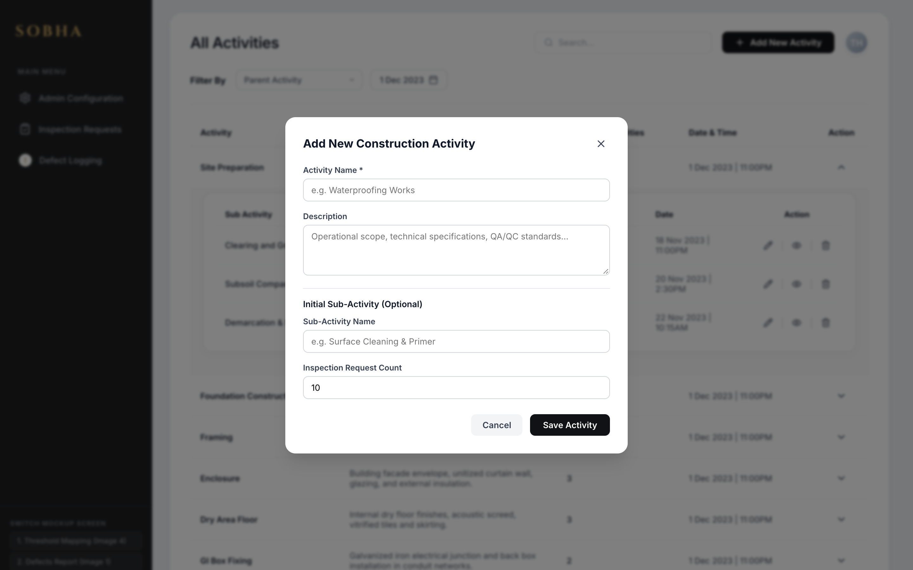
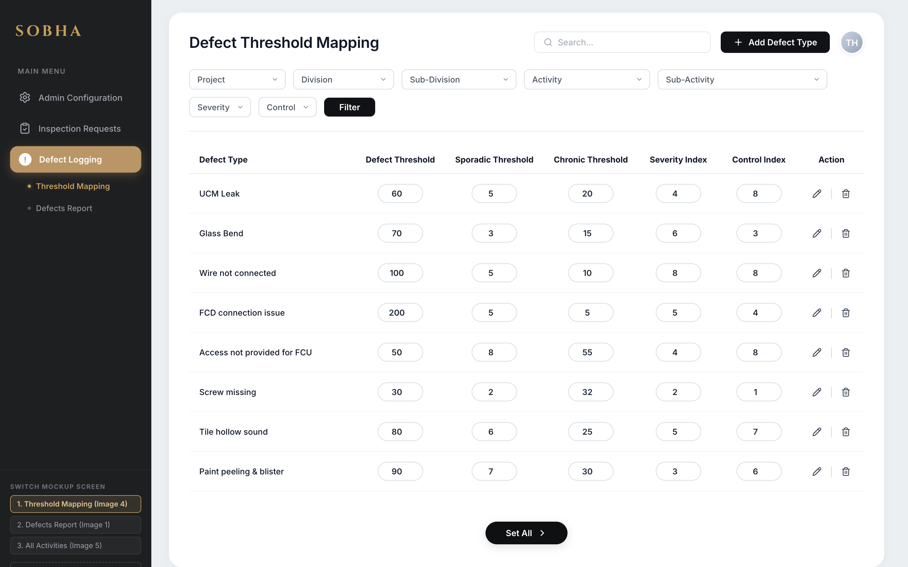
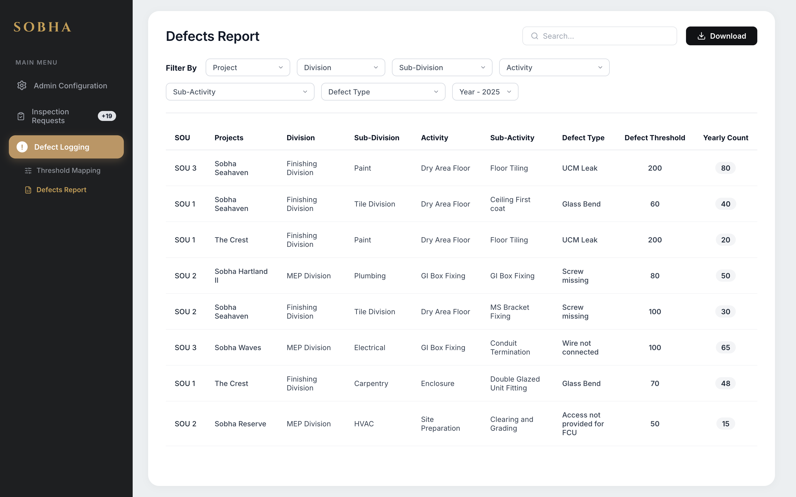
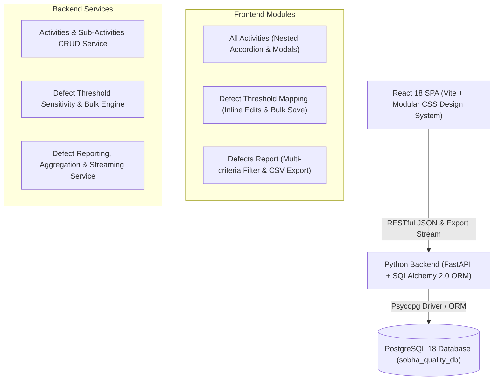

# SOBHA Quality & Defect Management System

> **Candidate**: Tehzeeb Hussain  
> **Evaluation For**: Talent Acquisition | Sobha Ltd / Sobha Realty  
> **Tech Stack**: **React.js 18** (Vite SPA) + **Python 3** (FastAPI & SQLAlchemy ORM) + **PostgreSQL 18**

---

## 🏗️ Project Overview

The **SOBHA Quality & Defect Management System** is a full-stack enterprise web application designed for construction and real estate quality operations. It enables project managers, quality leads, and site inspectors across **Sobha Operating Units (SOUs)** to track hierarchical site activities, configure defect threshold sensitivity mappings, and audit yearly defect incident reports.

---

## 📸 Developed Application Screenshots

The application replicates the Sobha design system with high fidelity:

### 1. Construction Activities & Inspection Requests
*Expandable hierarchical accordion with parent activities and nested sub-activity inspection cards, real-time search, and date filters.*


### 2. Activity Creation Dialog
*Modal workflow for registering new construction activities and sub-activities.*


### 3. Defect Threshold Sensitivity Configuration
*Configurable threshold table with defect thresholds, sporadic thresholds, chronic thresholds, severity & control indices, and bulk database persistence.*


### 4. Quality Audit & Defects Report
*Multi-dimensional audit report across SOUs, projects, divisions, activities, and defect types with live filtering and CSV export.*


---

## 🏛️ System Architecture



---

## 🗄️ Database Design (PostgreSQL)

The database schema models the multi-tier hierarchy of Sobha construction quality control:

1. **`projects`**: Flagship developments (*Sobha Seahaven*, *The Crest*, *Sobha Hartland II*, *Sobha Waves*, *Sobha Reserve*) linked to SOUs (*SOU 1*, *SOU 2*, *SOU 3*).
2. **`divisions` & `sub_divisions`**: Specialized engineering divisions (*Finishing Division* -> *Paint*, *Tile Division*; *MEP Division* -> *Plumbing*, *Electrical*, *HVAC*).
3. **`activities` & `sub_activities`**: Site construction tasks with inspection counts and timestamps (*Site Preparation* -> *Clearing and Grading*, *Subsoil Compaction*; *Dry Area Floor* -> *Floor Tiling*, *Ceiling First coat*).
4. **`defect_threshold_mappings`**: Quality benchmarks (*UCM Leak*, *Glass Bend*, *Wire not connected*, *FCD connection issue*, *Access not provided for FCU*, *Screw missing*) with numeric thresholds, severity index (1-10), and control index (1-10).
5. **`defect_report_logs`**: Recorded defect counts per project, division, activity, defect type, and audit year (2025, 2024).

---

## 🔌 RESTful API Reference

| Method | Endpoint | Description |
|---|---|---|
| `GET` | `/api/health` | Healthcheck endpoint |
| `GET` | `/api/filter-options` | Dynamic dropdown filter options (projects, divisions, defect types, etc.) |
| `GET` | `/api/activities` | Fetch all activities with nested sub-activities & search |
| `POST` | `/api/activities` | Create a new construction activity |
| `PUT` | `/api/activities/{id}` | Update activity details |
| `DELETE` | `/api/activities/{id}` | Delete an activity |
| `POST` | `/api/activities/{id}/sub-activities` | Add a sub-activity to an existing activity |
| `PUT` | `/api/sub-activities/{id}` | Update sub-activity details & inspection request count |
| `DELETE` | `/api/sub-activities/{id}` | Delete sub-activity |
| `GET` | `/api/threshold-mappings` | Query defect threshold mappings with multi-attribute filtering |
| `POST` | `/api/threshold-mappings` | Create a new defect threshold category |
| `PUT` | `/api/threshold-mappings/{id}` | Update threshold parameters |
| `DELETE` | `/api/threshold-mappings/{id}` | Delete threshold category |
| `POST` | `/api/threshold-mappings/bulk-update` | Bulk update all threshold rows (`Set All >` action) |
| `GET` | `/api/defects-report` | Filtered defect reports query |
| `GET` | `/api/defects-report/export` | Stream and download filtered defect report as CSV |

Interactive Swagger documentation is available at **`http://127.0.0.1:8000/docs`**.

---

## 🚀 Quickstart & Setup Guide

### Option 1: One-Command Docker Setup (Recommended for Interviewers)
The fastest way to test the full stack with PostgreSQL without installing any local databases or dependencies:
```bash
docker compose up --build
```
* **Frontend**: `http://localhost:5173`
* **FastAPI Backend**: `http://localhost:8000`
* **PostgreSQL Database**: runs in container on port `5432` with pre-seeded data.

---

### Option 2: Running PostgreSQL Locally

#### A. Using Docker for PostgreSQL Only
If you prefer running the backend and frontend on your host machine:
```bash
docker run -d --name sobha_pg -p 5432:5432 \
  -e POSTGRES_USER=postgres \
  -e POSTGRES_PASSWORD=postgres \
  -e POSTGRES_DB=sobha_quality_db \
  postgres:16-alpine
```

#### B. Installing Native PostgreSQL
* **macOS (Homebrew)**:
  ```bash
  brew install postgresql@16
  brew services start postgresql@16
  createdb sobha_quality_db
  ```
* **Ubuntu / Debian**:
  ```bash
  sudo apt update && sudo apt install -y postgresql postgresql-contrib
  sudo systemctl start postgresql
  sudo -u postgres createdb sobha_quality_db
  ```
* **Windows**: Download the official installer from [postgresql.org/download](https://www.postgresql.org/download/windows/).

---

### Option 3: Standard Local Execution

#### 1. Backend Setup
```bash
cd backend
python3 -m venv venv
source venv/bin/activate
pip install -r requirements.txt

# Run server (tables and seed data are populated automatically on startup)
uvicorn main:app --host 0.0.0.0 --port 8000 --reload
```
> **Note on Zero-Config Fallback**: If PostgreSQL is not detected, the application automatically falls back to an embedded database with pre-loaded baseline records, guaranteeing zero setup friction during review.

#### 2. Frontend Setup
```bash
cd frontend
npm install
npm run dev
```

#### 3. One-Click Startup Script (Local)
```bash
./start.sh
```

---

## 🎨 Design System Implementation Highlights

* **Brand Aesthetics**: Custom luxury Sobha color tokens including charcoal sidebar (`#1E1F21`), warm gold accents (`#D4AF37`), and tan active pill states (`#B9935A`).
* **Nested Accordion**: Reusable multi-level row expansion showing nested inspection request cards.
* **Inline Editable Thresholds**: Rounded pill inputs matching the wireframe with batch synchronization via `Set All >`.
* **Instant Export**: Real-time CSV generation reflecting current table filters.
